  

### Hi, I'm Dien 👋

I run the tech behind two small businesses in St. Pete, and I build automation for other local businesses: online ordering, payments, billing and the customer messaging around them. So far that is a run coach and market vendors, with a salon next. I also build labs to show I can do the same work inside a corporate network.

Owning real systems taught me the part no certification covers. When it breaks on a Saturday morning, it is yours to fix.

**Looking for:** a role in IT support, security operations or solutions engineering in the Tampa Bay area. U.S. citizen, able to obtain a security clearance.

## 🛰️ Featured work

| | Project | What I built | Stack |
| :---: | :--- | :--- | :--- |
| 🟢 | [**Active Directory Home Lab**](https://github.com/DienDoesData/active-directory-home-lab) Public | A Windows Server domain for a fictional 31-person company. Users provisioned by script, ten help desk tickets worked with before-and-after evidence, lockout and password policy, and a Splunk dashboard of failed logins. | Windows Server 2025 · Active Directory · Group Policy · PowerShell · Splunk · Azure |
| 🔒 | [**Mona's Fresh Market**](https://monasmarket.shop) Live · code private | Order-ahead storefront for a family farmers market stand. Customers order and pay online, the stand gets a prep list, and confirmations go out by text. I built and run the site, the payments, the messaging and the uptime. | JavaScript · serverless functions · Stripe · Twilio · Google Apps Script · Netlify |
| 🔒 | **Vendor storefront engine** Live · code private | The same ordering system packaged so another business can run on it with its own accounts, branding and payments. Now runs more than one shop, including [coconutking.shop](https://coconutking.shop). | Shared engine · per-vendor configuration · Stripe · Netlify |
| 🔧 | **RunWithKat client billing** In build · code private | Automation for a run-coaching business: client sign-up and agreements, automatic monthly billing, failed-payment alerts, a paid and unpaid dashboard, and coach payouts. Built so the client owns every account outright. | Stripe · Supabase (Postgres) · Twilio · Netlify |
| 🔒 | [**Curbside Brothers Junk Removal**](https://curbsidebros.com) Live · code private | Company site with more than 50 city pages built by a Python generator, plus the search listings, quote form and tracking behind it. | Python · static site generation · Netlify · Search Console |

Private repositories hold customer and payment configuration, so the code stays closed. I am glad to walk through any of them on a call.

## 🧰 Toolbox

  

## 🎓 Certifications

  
  &nbsp;&nbsp;
  
  &nbsp;&nbsp;
  
  &nbsp;&nbsp;
  

| Certification | Issuer | Status |
| :--- | :--- | :--- |
| Security+ ce | CompTIA | Active through April 11, 2027 |
| Network+ ce | CompTIA | Active through April 11, 2027 |
| Splunk Core Certified User | Splunk | Active through May 6, 2027 |
| Azure Fundamentals | Microsoft | Issued February 7, 2024 |

Badges are issued through Credly and can be verified on [my Credly profile](https://www.credly.com/users/nour-eldien-elsayed).

## 📊 Data projects

I also have SQL and Python analysis projects on vacation rentals, e-commerce retention and retail returns. They are under [Repositories](https://github.com/DienDoesData?tab=repositories).

## 📡 Get in touch

Hiring for IT support or security operations, or need ordering, billing or operations automated for your business? I'd like to talk.

[**LinkedIn**](https://www.linkedin.com/in/dien-elsayed/) &nbsp;·&nbsp; [**dien.me@icloud.com**](mailto:dien.me@icloud.com)
